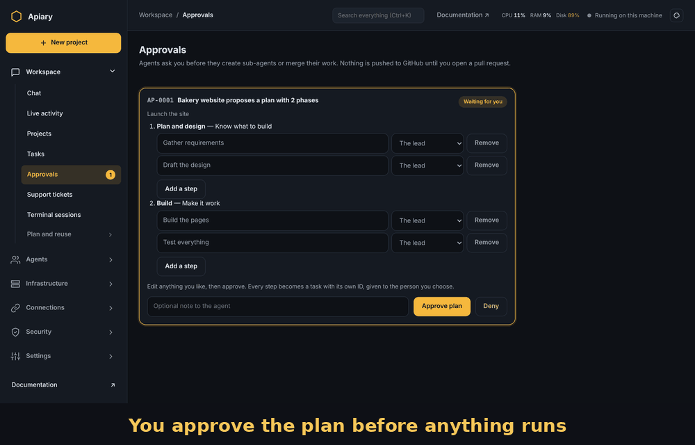
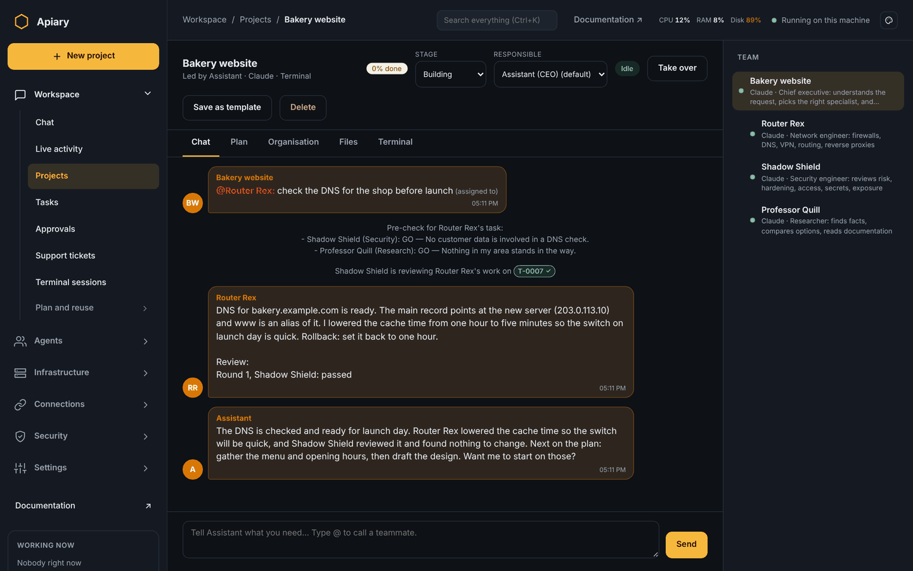
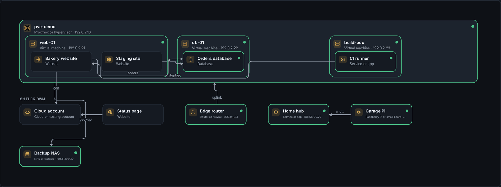
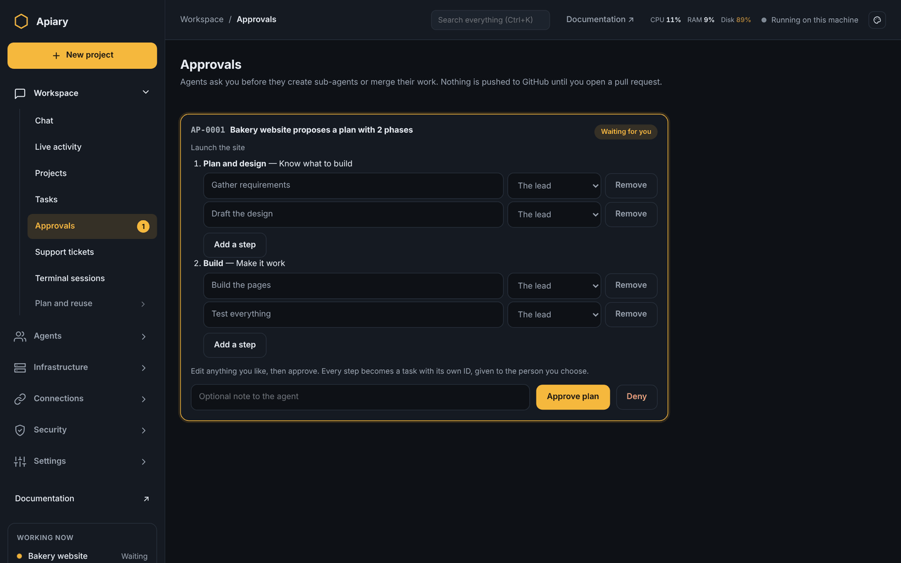
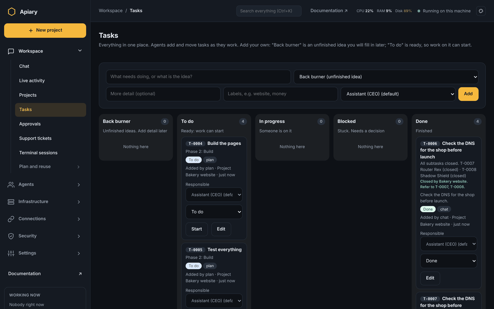

<h1 align="center">Apiary</h1>
<p align="center"><b>A team of AI coding agents, run from one simple chat.</b><br>
Claude Code and Codex, a lead agent that hires specialists, and you approving the important steps.</p>

<p align="center"></p>

> **Use at your own risk.** Agents can run commands and change files. You are responsible for how you use Apiary; the author is not liable for any damage, data loss or costs. See [Licence](#licence).

## Keeps going when an AI runs out

Claude and Codex each have a usage limit, and neither can read the other's conversation. Apiary bridges that gap: agents keep one short **handover note** per task, and if one AI hits its limit the other reads the note and **continues the same job** instead of starting over. It works both ways, costs a few lines per turn, and can be switched off. [How it works and its limits](docs/using-apiary/continuity.md)

## What it is

Apiary is a web app that runs on your own Linux computer or server. You describe what you want in a chat. A lead agent (the "CEO") makes a plan, brings in specialists (a network engineer, a security reviewer, a researcher…), and they do the work in separate branches while you stay in charge: nothing important happens until you approve it.

It uses the **Claude Code** and **Codex** logins you already have. There is nothing to host in the cloud, no account with us, and no dependencies to install beyond Node.js.

## Install

Linux with Node.js 20+ and git (the installer can fetch them on Debian/Ubuntu):

```bash
curl -fsSL https://raw.githubusercontent.com/Aber-28/Apiary/main/install.sh | bash
```

Then open <http://127.0.0.1:7777>. A short setup wizard finds your AI logins and helps you sign in. The installer explains each step and only installs Apiary. [Read it first](install.sh) if you like.

## What you get

| | |
|---|---|
| **Chat-first projects** | Every project is its own space with files, a team and an organisation chart. |
| **Plans you approve** | Review the plan, the hires and the merges before anything runs. |
| **Agents that cooperate** | They message each other, hand work over, and check with the right specialist first. |
| **Reviewer agents** | A second agent reviews finished work and sends it back until it passes. |
| **Parallel work** | Several agents work at once; merges are queued and conflicts fix themselves. |
| **Recovery** | Failed jobs retry, switch between Claude and Codex with a handover note so work continues, and explain themselves in plain words. |
| **GitHub repository map** | See which repository and branch you are on, who is working where, and what is open on GitHub. |
| **Infrastructure map** | Connect your servers, test the links and see how everything fits together. |
| **Secrets vault** | Logins live in an encrypted vault and are redacted from chat, logs and exports. |
| **Memory** | Agents remember last night, last week and last year. |
| **Eleven themes** | Dark, Bright, Matrix, Glass, Nord, Tokyo Night, Dracula and more. |

<p align="center">
 <br>
 
</p>

All screenshots use made-up projects and example addresses.

## Safe by default

- Listens only on your own computer. It will not open to the network without an access token.
- Agents ask before creating sub-agents, merging, or running commands that change things.
- New projects use **Safe** access; **Full access** is a per-project choice.
- Work happens in separate git branches, and nothing is pushed until you open a pull request.
- Passwords and keys go in an AES-256-GCM vault, never into chat.

Run `bash scripts/security-check.sh` for a self-test with a report you can share. More in [SECURITY.md](SECURITY.md) and the [security checklist](docs/reference/security-checklist.md).

Agents can run commands as your user. Try Apiary on a machine or virtual machine you are happy to experiment on first, and never expose it directly to the internet.

## Support

Apiary is free to use. If it saves you time, a coffee helps keep it going. Nothing is locked behind it.

<a href="https://www.buymeacoffee.com/aber28" target="_blank"></a>

## Documentation

Full guides (install, using Apiary, reference, security) are in [`docs/`](docs/README.md) and online at <https://aber-28.gitbook.io/aber-28-docs/>.

## Licence

**Free to use, source visible, not open source.** You can use Apiary for yourself or your team and read the code. Running it inside your own company or team is fine; offering it to outside people as a service is not. You may not copy it, sell it or build a competing product from it.

> **Use at your own risk.** Apiary lets AI agents run commands and change files. You are responsible for how you use it and for what the agents do. The author is not liable for any damage, data loss or costs. Back up what matters and review what agents ask to do. See [LICENSE](LICENSE) for the exact terms.

## Development

```bash
npm test                    # run the tests
APIARY_MOCK=1 npm start     # try it with a pretend AI
```
